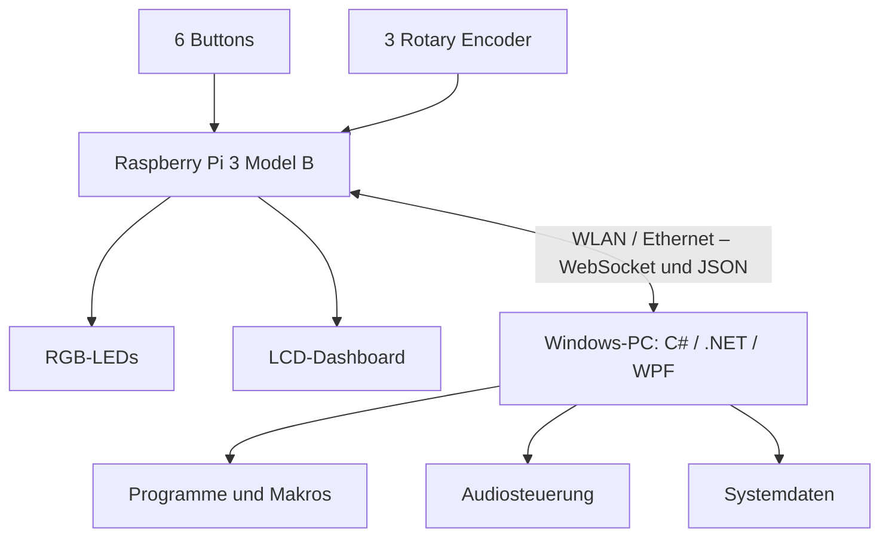

# Projektdokumentation
# DIY Stream Deck – Individuell programmierbares Steuerungsgerät

| Projektdaten | Angaben |
|---|---|
| Projektname | DIY Stream Deck |
| Version | 2.0 – RGB Edition |
| Projektbeginn | 26.11.2026 |
| Projektbereich | Applikationsentwicklung, Hardwareentwicklung und 3D-Druck |
| Entwicklungsplattform | Raspberry Pi 3 Model B V1.2 |
| CAD-Software | FreeCAD 1.1.4 |
| 3D-Drucker | Bambu Lab X1 Carbon mit AMS |
| Status | In Entwicklung |

## Inhaltsverzeichnis

1. [Projektbeschreibung](#1-projektbeschreibung)
2. [Ausgangssituation](#2-ausgangssituation)
3. [Projektziele](#3-projektziele)
4. [Funktionsumfang](#4-funktionsumfang)
5. [Anforderungsanalyse](#5-anforderungsanalyse)
6. [Hardwarekomponenten](#6-hardwarekomponenten)
7. [Technische Architektur](#7-technische-architektur)
8. [GPIO-Anschlüsse und Verkabelung](#8-gpio-anschlüsse-und-verkabelung)
9. [CAD-Konstruktion](#9-cad-konstruktion)
10. [Gehäuseaufbau](#10-gehäuseaufbau)
11. [Buttons und Keycaps](#11-buttons-und-keycaps)
12. [Drehregler](#12-drehregler)
13. [LCD-Display](#13-lcd-display)
14. [RGB-Beleuchtung](#14-rgb-beleuchtung)
15. [Stromversorgung](#15-stromversorgung)
16. [Softwareentwicklung](#16-softwareentwicklung)
17. [Kommunikation zwischen Raspberry Pi und PC](#17-kommunikation-zwischen-raspberry-pi-und-pc)
18. [Benutzeroberfläche](#18-benutzeroberfläche)
19. [3D-Druck und Fertigung](#19-3d-druck-und-fertigung)
20. [Zusammenbau](#20-zusammenbau)
21. [Kostenplanung](#21-kostenplanung)
22. [Projektphasen](#22-projektphasen)
23. [Testkonzept und Qualitätssicherung](#23-testkonzept-und-qualitätssicherung)
24. [Risiken und Herausforderungen](#24-risiken-und-herausforderungen)
25. [Erweiterungsmöglichkeiten](#25-erweiterungsmöglichkeiten)
26. [Aktueller Projektstand](#26-aktueller-projektstand)
27. [Fazit](#27-fazit)

---

## 1. Projektbeschreibung

Im Rahmen dieses Projekts wird ein individuell entwickeltes Stream Deck konstruiert, programmiert und hergestellt. Das Gerät soll als externe Steuerungseinheit für einen Windows-PC dienen und verschiedene Programme, Systemfunktionen sowie Multimedia-Anwendungen bedienen können.

Im Gegensatz zu herkömmlichen kommerziellen Stream Decks wird das gesamte Gerät eigenständig entwickelt. Dazu gehören die mechanische Konstruktion des Gehäuses, die Integration elektronischer Komponenten, die Programmierung der Hardwaresteuerung sowie die Entwicklung einer eigenen Windows-Anwendung.

Das Stream Deck besteht aus sechs programmierbaren mechanischen Tasten, drei Drehreglern und einem vertikal ausgerichteten LCD-Farbdisplay. Zusätzlich sollen sämtliche Tasten über individuell steuerbare RGB-Beleuchtung verfügen.

Als zentrale Steuereinheit wird ein Raspberry Pi 3 Model B V1.2 verwendet. Das Gehäuse und die mechanischen Bedienelemente werden mithilfe von FreeCAD konstruiert und anschließend mit einem Bambu Lab X1 Carbon gefertigt.

## 2. Ausgangssituation

Kommerzielle Stream Decks bieten zahlreiche Funktionen, sind jedoch häufig mit höheren Anschaffungskosten verbunden und besitzen einen vorgegebenen mechanischen Aufbau. Durch die eigenständige Entwicklung können sowohl Hardware als auch Software vollständig an individuelle Anforderungen angepasst werden.

Die ursprüngliche Planung sah die Verwendung eines Raspberry Pi Zero 2 W vor. Im weiteren Projektverlauf wurde jedoch ein bereits vorhandener Raspberry Pi 3 Model B V1.2 als alternative Entwicklungsplattform ausgewählt. Dadurch können Anschaffungskosten reduziert und gleichzeitig mehr Arbeitsspeicher sowie zusätzliche Anschlussmöglichkeiten genutzt werden.

Die Änderung der Hardware erfordert eine Anpassung der ursprünglichen CAD-Konstruktion, insbesondere der Platinenhalterung, der Anschlussöffnungen und des internen Platzbedarfs.

## 3. Projektziele

### 3.1 Hauptziel

Entwicklung eines funktionsfähigen, individuell konfigurierbaren Stream Decks, welches die Bedienung eines Windows-PCs vereinfacht und wichtige Systeminformationen übersichtlich darstellt.

### 3.2 Technische Ziele

- Entwicklung eines eigenen Elektronikgehäuses.
- Integration eines Raspberry Pi 3 Model B.
- Integration von sechs mechanischen Tasten, drei digitalen Drehreglern und einem LCD-Farbdisplay.
- Entwicklung einer individuellen RGB-Beleuchtung.
- Entwicklung einer Windows-Konfigurationssoftware.
- Aufbau einer bidirektionalen Netzwerkkommunikation.
- Anzeige aktueller PC-Systeminformationen.
- Herstellung der mechanischen Komponenten mittels 3D-Druck.

### 3.3 Gestalterische Ziele

- Minimalistisches Design und dunkles Gehäuse.
- Abgerundete Außenkanten.
- Flache mechanische Tasten.
- Glatte Drehregler ohne Riffelung.
- Beleuchtete Funktionssymbole.
- Möglichst geringe sichtbare Spaltmaße.
- Verdeckte Befestigungselemente.
- Abnehmbare Bodenplatte.

## 4. Funktionsumfang

### 4.1 Mechanische Tasten

| ID | Funktion | Beschreibung |
|---|---|---|
| B1 | Discord öffnen | Startet die Discord-Anwendung. |
| B2 | Mikrofon stummschalten | Aktiviert oder deaktiviert das Mikrofon. |
| B3 | Discord Deafen | Deaktiviert Audioausgabe und Mikrofon innerhalb von Discord. |
| B4 | Browser öffnen | Startet den konfigurierten Internetbrowser. |
| B5 | Musik Play/Pause | Pausiert oder startet die aktuelle Medienwiedergabe. |
| B6 | Clip erstellen | Löst die Aufnahme eines Gaming-Clips aus. |

Die Funktionen sollen später über die eigene Konfigurationssoftware verändert werden können.

### 4.2 Drehregler

| ID | Funktion | Beschreibung |
|---|---|---|
| D1 | PC-Lautstärke | Erhöht oder reduziert die Systemlautstärke. |
| D2 | Mikrofonlautstärke | Verändert den Eingangspegel des Mikrofons. |
| D3 | Bildschirmhelligkeit | Verändert die Helligkeit eines kompatiblen Monitors. |

Die Drehregler sollen vorzugsweise zusätzlich über eine Druckfunktion verfügen, sofern die eingesetzten Rotary Encoder diese unterstützen. Mögliche zusätzliche Funktionen sind das Stummschalten der jeweiligen Audioquelle oder das Zurücksetzen eines Wertes.

### 4.3 Systemmonitor

Das LCD soll CPU-, GPU-, RAM- und VRAM-Auslastung, CPU- und GPU-Temperatur, Uhrzeit, Netzwerkverbindungsstatus, Mikrofonstatus, Lautstärke und optional FPS anzeigen. Die Verfügbarkeit einzelner Messwerte hängt von PC-Hardware und Softwareschnittstellen ab.

## 5. Anforderungsanalyse

### 5.1 Funktionale Anforderungen

| ID | Anforderung | Priorität |
|---|---|---|
| FA01 | Erkennung aller sechs Tasteneingaben | Hoch |
| FA02 | Erkennung der drei Drehregler | Hoch |
| FA03 | Kommunikation mit Windows-PC | Hoch |
| FA04 | Ausführung konfigurierbarer Aktionen | Hoch |
| FA05 | Anzeige von Systeminformationen | Hoch |
| FA06 | Individuelle RGB-Steuerung | Hoch |
| FA07 | Speicherung von Benutzerprofilen | Mittel |
| FA08 | Automatische Wiederverbindung | Hoch |
| FA09 | Anzeige aktueller Mikrofonzustände | Mittel |
| FA10 | Unterstützung zusätzlicher Makros | Mittel |
| FA11 | Austauschbare Hardwarekomponenten | Mittel |
| FA12 | Unterstützung mehrerer Monitore | Optional |

### 5.2 Nichtfunktionale Anforderungen

- Möglichst geringe Eingabeverzögerung, hohe Zuverlässigkeit und einfache Bedienung.
- Wartungsfreundlicher Aufbau und modularer Softwareaufbau.
- Stabile Netzwerkkommunikation.
- Kompakte Gehäuseabmessungen und geringe Wärmeentwicklung.
- Sichere elektrische Versorgung.
- Gute Erweiterbarkeit und reproduzierbare 3D-Druck-Ergebnisse.

Als angestrebter Richtwert soll die Verzögerung zwischen Tastendruck und Programmausführung im lokalen Netzwerk möglichst unter 50 Millisekunden liegen, sofern die ausgeführte Aktion dies zulässt. Dieser Wert muss durch praktische Messungen überprüft werden.

## 6. Hardwarekomponenten

### 6.1 Raspberry Pi 3 Model B V1.2

Der Raspberry Pi übernimmt die Verarbeitung der Hardwareeingaben, die Steuerung der RGB-Beleuchtung, die Darstellung der LCD-Oberfläche und die Netzwerkkommunikation.

| Eigenschaft | Spezifikation |
|---|---|
| Modell | Raspberry Pi 3 Model B V1.2 |
| Prozessor | Broadcom BCM2837 |
| Architektur | ARM Cortex-A53 |
| CPU-Kerne / Taktrate | 4 / 1,2 GHz |
| Arbeitsspeicher | 1 GB RAM |
| GPIO | 40-Pin-Header |
| USB | 4 × USB 2.0 |
| Netzwerk | Ethernet und WLAN |
| Bluetooth | Bluetooth 4.1 / BLE |
| Stromanschluss | Micro-USB |
| Empfohlene Stromversorgung | 5,1 V / 2,5 A |
| Platinenabmessungen | 85 × 56 mm |
| Befestigungslochabstände | 58 × 49 mm |
| Betriebssystemspeicher | MicroSD, vorgesehen 32 GB |

### 6.2 Mechanische Switches

Sechs mechanische, vorzugsweise RGB-kompatible Switches mit transparentem Gehäuse oder geeignetem Lichtkanal. Das genaue Modell steht noch nicht fest.

### 6.3 Rotary Encoder

Drei digitale Rotary Encoder, vorläufig EC11-kompatible Bauform.

### 6.4 LCD-Display

Kompaktes LCD-Farbdisplay, vertikal auf der rechten Gehäuseseite. Das endgültige Modell ist noch nicht ausgewählt.

### 6.5 RGB-LEDs

Einzeln adressierbare RGB-LEDs, beispielsweise WS2812B-kompatible LEDs.

### 6.6 Stückliste

| Komponente | Anzahl |
|---|---:|
| Raspberry Pi 3 Model B | 1 |
| MicroSD-Karte, 32 GB | 1 |
| Mechanische RGB-kompatible Switches | 6 |
| Individuell gefertigte Keycaps | 6 |
| Rotary Encoder | 3 |
| Individuell gefertigte Drehknopf-Kappen | 3 |
| LCD-Farbdisplay | 1 |
| Adressierbare RGB-LEDs | Mindestens 6 |
| Logikpegelwandler | 1 |
| Geeignetes Netzteil | 1 |
| Pufferkondensator | 1 |
| Widerstände | Nach Bedarf |
| Verbindungskabel | Nach Bedarf |
| M2,5-Befestigungsschrauben | 4 |
| M3-Gehäuseschrauben | 4 |
| Gewindeeinsätze oder Muttern | 4 |
| Gummifüße | 4 |
| PLA- oder PETG-Filament | Nach Bedarf |
| Lichtdurchlässiges Filament | Nach Bedarf |

## 7. Technische Architektur

Das Stream Deck wird in Eingabeverarbeitung, zentrale Hardwaresteuerung, RGB-Beleuchtung, Displaysteuerung, Netzwerkkommunikation, Windows-Hintergrundanwendung und Windows-Konfigurationssoftware unterteilt.

Der Raspberry Pi erkennt die Eingaben über GPIO und leitet sie über das lokale Netzwerk an die Windows-Anwendung weiter. Diese führt die zugewiesenen Aktionen aus und übermittelt Rückmeldungen. Systeminformationen werden regelmäßig an den Pi übertragen und auf dem LCD dargestellt. Die RGB-Beleuchtung reagiert auf die Rückmeldungen.



## 8. GPIO-Anschlüsse und Verkabelung

### 8.1 Vorläufige GPIO-Belegung

Die folgende Belegung verwendet die BCM-Nummerierung und muss nach Auswahl des LCD-Displays und der RGB-Steuerung auf Konflikte überprüft werden.

| Komponente | Funktion | BCM-GPIO |
|---|---|---:|
| Button 1 | Discord | 5 |
| Button 2 | Mikrofon Mute | 6 |
| Button 3 | Discord Deafen | 13 |
| Button 4 | Browser | 19 |
| Button 5 | Play/Pause | 26 |
| Button 6 | Clip | 16 |
| Encoder 1 | Kanal A | 17 |
| Encoder 1 | Kanal B | 27 |
| Encoder 2 | Kanal A | 22 |
| Encoder 2 | Kanal B | 23 |
| Encoder 3 | Kanal A | 24 |
| Encoder 3 | Kanal B | 25 |
| RGB-LEDs | Datensignal | 18 |

Die SPI-Pins werden für ein mögliches SPI-Display freigehalten. Zusätzliche Encoder-Druckfunktionen können gegebenenfalls über einen MCP23017-GPIO-Expander realisiert werden.

### 8.2 Tastenverkabelung

Die Switches werden zwischen GPIO und Masse angeschlossen. Interne Pull-up-Widerstände können einen definierten Signalzustand sicherstellen. Eine softwareseitige Entprellung soll Mehrfachsignale verhindern.

### 8.3 Drehreglerverkabelung

Jeder Encoder besitzt zwei Signalkanäle zur Erkennung der Drehrichtung. Die Software wertet die Signalfolge aus. Optional können schnelle Drehbewegungen größere Wertänderungen auslösen.

### 8.4 Elektrische Sicherheit

Die GPIO-Anschlüsse arbeiten mit 3,3-V-Logik. Eine direkte Verbindung mit 5-V-Signalen kann den Raspberry Pi beschädigen. RGB-LEDs dürfen nicht über GPIO-Signalpins mit Strom versorgt werden.

## 9. CAD-Konstruktion

### 9.1 Verwendete Software

FreeCAD 1.1.4 ermöglicht parametrische 3D-Modellierung und CAD- sowie Mesh-Export. Verwendete beziehungsweise vorgesehene Funktionen: Sketcher, Part Design, Aufpolsterung (Pad), Tasche (Pocket), Verrundung (Fillet), Dicke (Thickness), lineare Muster, parametrische Tabellen und Baugruppen. KI-gestützte Entwicklungswerkzeuge unterstützen die Konstruktion und Automatisierung.

### 9.2 Konstruktionsprozess

1. Rechteckige Grundfläche von 180 × 115 mm erstellen.
2. Aufpolsterung auf 40 mm Höhe.
3. Volumenkörper mit der Funktion „Dicke“ aushöhlen, Wandstärke 3 mm.
4. Äußere vertikale Kanten mit 2 mm Radius abrunden.
5. Aussparungen für sechs Buttons, drei Drehregler und LCD konstruieren.
6. Weitere parametrische Anpassungen an die tatsächlichen Hardwarekomponenten vornehmen.

## 10. Gehäuseaufbau

### 10.1 Abmessungen

| Eigenschaft | Maß |
|---|---:|
| Gesamtbreite | 180 mm |
| Gesamttiefe | 115 mm |
| Höhe der Gehäuseschale | 40 mm |
| Wandstärke | 3 mm |
| Außenkantenradius | 2 mm |
| Geplante Bodenplattenstärke | 3 mm |

Die endgültige Gesamthöhe hängt davon ab, ob die Bodenplatte bündig eingelassen oder unterhalb der Schale befestigt wird. Die ungefähren Innenabmessungen betragen 174 × 109 × 37 mm, abzüglich Befestigungen, Rundungen und Bauteilen.

### 10.2 Gehäusekomponenten

- Obere Gehäuseschale und abnehmbare Bodenplatte.
- Raspberry-Pi-, Display-, Switch-, Encoder- und LED-Halterungen.
- Anschlussblende und Lüftungsöffnungen.
- Schraubensäulen, Kabelführungen und Gummifüße.

### 10.3 Bodenplatte

Die Bodenplatte wird separat gedruckt und verschraubt, damit die Elektronik zugänglich und wartbar bleibt. Die Raspberry-Pi-Halterung soll möglichst direkt in die Bodenplatte integriert werden.

## 11. Buttons und Keycaps

### 11.1 Positionierung

Koordinatenursprung: linke untere Gehäuseecke; alle Maße in mm.

| Button | Mittelpunkt X | Mittelpunkt Y |
|---|---:|---:|
| Discord | 27 | 90 |
| Mikrofon Mute | 60 | 90 |
| Discord Deafen | 93 | 90 |
| Browser | 27 | 57,5 |
| Musik Play/Pause | 60 | 57,5 |
| Clip | 93 | 57,5 |

Vorläufige Aussparungen: jeweils 14 × 14 mm.

### 11.2 Keycap-Design

| Eigenschaft | Entwurfsmaß |
|---|---:|
| Breite | 22 mm |
| Tiefe | 22 mm |
| Sichtbare Höhe über Gehäuse | 4–6 mm |
| Mittelpunktabstand horizontal | 33 mm |
| Mittelpunktabstand vertikal | 32,5 mm |
| Mindestlinienbreite der Symbole | ca. 0,8 mm |

Die endgültige Einbauhöhe muss anhand des Betätigungsweges und der Bauhöhe der tatsächlichen Switches überprüft werden.

### 11.3 Funktionssymbole

| Taste | Symbol |
|---|---|
| Discord | Discord-Logo |
| Mikrofon Mute | Durchgestrichenes Mikrofon |
| Discord Deafen | Durchgestrichener Kopfhörer |
| Browser | Globus |
| Musik | Play-/Pause-Symbol |
| Clip | Videokamera |

Die Symbole werden als reale CAD-Geometrie aus lichtdurchlässigem Material gefertigt. Der übrige Keycap-Körper besteht aus lichtundurchlässigem Material.

## 12. Drehregler

### 12.1 Positionierung

| Drehregler | Mittelpunkt X | Mittelpunkt Y |
|---|---:|---:|
| PC-Lautstärke | 27 | 25 |
| Mikrofonlautstärke | 60 | 25 |
| Bildschirmhelligkeit | 93 | 25 |

Vorläufiger Durchmesser der Montageöffnungen: 7 mm.

### 12.2 Drehknopf-Design

| Eigenschaft | Entwurfsmaß |
|---|---|
| Außendurchmesser | 24 mm |
| Sichtbare Höhe | 8–10 mm |
| Oberfläche | Glatt, ohne Riffelung |
| Oberkante | Abgerundet |
| Material | PLA oder PETG |

Die Oberseiten erhalten individuelle Symbole: Lautsprecher, Mikrofon und Sonne. Optional ist ein dezenter RGB-Lichtring unter jedem Drehknopf vorgesehen.

## 13. LCD-Display

### 13.1 Positionierung

| Eigenschaft | Entwurfsmaß |
|---|---:|
| Aussparungsbreite | 41 mm |
| Aussparungshöhe | 82,5 mm |
| Untere linke Ecke X | 125 mm |
| Untere linke Ecke Y | 16,5 mm |
| Obere rechte Ecke X | 166 mm |
| Obere rechte Ecke Y | 99 mm |
| Mittelpunkt X | 145,5 mm |
| Mittelpunkt Y | 57,75 mm |

Diese Maße beschreiben die CAD-Aussparung, nicht die bestätigten Abmessungen eines ausgewählten LCD-Moduls.

### 13.2 Display-Halterung

Befestigung von innen, sichere Fixierung der Platine und Schutz der empfindlichen Displayflächen vor mechanischem Druck. Eine bündige Montage wird angestrebt.

### 13.3 Darstellung

Modernes dunkles Dashboard mit violetten Akzentfarben, Kreisdiagrammen, Fortschrittsbalken, Prozent- und Temperaturanzeigen, Liniendiagrammen und Statussymbolen.

## 14. RGB-Beleuchtung

### 14.1 Beleuchtungskonzept

Jede Taste soll individuell steuerbar sein. Die Beleuchtung dient sowohl der Gestaltung als auch der Statusanzeige. Vorgesehen sind einzeln adressierbare RGB-LEDs.

### 14.2 Lichtführung

Ein gewöhnlicher LED-Streifen im Gehäuse ermöglicht allgemeine Innenbeleuchtung, aber keine zuverlässige gleichmäßige Ausleuchtung der Symbole. Deshalb werden LEDs gezielt unter oder neben den Switches positioniert.

1. RGB-LED.
2. Transparenter beziehungsweise RGB-kompatibler Switch.
3. Lichtkanal oder Diffusor.
4. Lichtdurchlässiges Keycap-Symbol.
5. Lichtundurchlässiger Keycap-Körper.

Trennwände sollen Lichtübersprechen zwischen den Tasten verhindern.

### 14.3 Statusbeleuchtung

| Zustand | Beleuchtung |
|---|---|
| Normalbetrieb | Individuell konfigurierbare Farbe |
| Mikrofon stumm | Rot |
| Mikrofon aktiv | Grün oder Standardfarbe |
| Discord Deafen aktiv | Rot |
| Clip gespeichert | Kurzes grünes Aufleuchten |
| Musik pausiert | Gedimmte Beleuchtung |
| Netzwerk getrennt | Orange blinkend |
| Verbindung hergestellt | Kurzes grünes Aufleuchten |

### 14.4 Mehrfarbiger 3D-Druck

Das AMS ermöglicht die Verwendung mehrerer Filamente. Vorgesehen sind lichtundurchlässiges schwarzes und lichtdurchlässiges beziehungsweise transluzentes Filament. Eine einzelne Test-Keycap soll vorab auf Passung, Stabilität und Lichtdurchlässigkeit geprüft werden.

## 15. Stromversorgung

| Verbraucher | Vorläufiger Planungswert |
|---|---|
| Raspberry Pi 3 B | Bis ca. 2,5 A Versorgungsbudget |
| 6 RGB-LEDs | Bis ca. 0,36 A |
| LCD-Display | Abhängig vom Modell |
| Optionale RGB-Lichtringe | Abhängig von LED-Anzahl |
| Weitere Elektronik | Abhängig von Ausstattung |

Die LED-Werte basieren auf einem konservativen Richtwert von bis zu 60 mA pro LED bei maximaler Helligkeit und Weiß. Der tatsächliche Verbrauch hängt vom LED-Modell ab.

Der Pi benötigt eine stabilisierte Micro-USB-Stromversorgung. Die LEDs benötigen gegebenenfalls eine zusätzliche 5-V-Versorgung. Für die Datenleitung ist ein geeigneter Logikpegelwandler vorgesehen, beispielsweise 74AHCT125.

Weitere Maßnahmen: Serienwiderstand in der LED-Datenleitung, Pufferkondensator, gemeinsame Masse, ausreichend dimensionierte Leitungen und sichere Steckverbindungen. Die endgültige Stromversorgung wird nach Komponentenauswahl dimensioniert. Unbeabsichtigte Rückspeisung zwischen getrennten Stromversorgungen muss vermieden werden.

## 16. Softwareentwicklung

### 16.1 Technologien

| Technologie | Verwendung |
|---|---|
| Python | Raspberry-Pi-Hardwaresteuerung |
| C# | Windows-Anwendung |
| WPF | Grafische Windows-Benutzeroberfläche |
| .NET | Anwendungsplattform |
| JSON | Konfiguration und Datenaustausch |
| WebSockets | Bidirektionale Netzwerkkommunikation |
| Raspberry Pi OS Lite | Betriebssystem |
| Git | Versionsverwaltung |
| Pygame oder Pillow | LCD-Darstellung, abhängig vom Display |
| gpiozero oder geeignete GPIO-Bibliothek | Eingabeverarbeitung |

### 16.2 Raspberry-Pi-Software

- Initialisierung der GPIO-Anschlüsse.
- Erkennung und Entprellung von Tastendrücken.
- Erkennung von Drehbewegungen.
- RGB-Steuerung.
- Netzwerkverbindung und Statusverarbeitung.
- LCD-Darstellung.
- Automatischer Programmstart und Wiederverbindung.

### 16.3 Geplante Python-Projektstruktur

```text
streamdeck-pi/
├── main.py
├── config.json
├── hardware/
│   ├── buttons.py
│   ├── encoders.py
│   ├── rgb.py
│   └── display.py
├── network/
│   ├── websocket_client.py
│   └── protocol.py
├── ui/
│   ├── dashboard.py
│   └── widgets.py
├── services/
│   ├── connection_manager.py
│   └── state_manager.py
├── assets/
└── requirements.txt
```

Die modulare Aufteilung ermöglicht unabhängige Entwicklung und Tests.

### 16.4 Windows-Anwendung

Die Windows-Anwendung in C# besteht aus Hintergrundkomponente und grafischer Konfigurationsoberfläche. Die Hintergrundkomponente empfängt Nachrichten und führt Aktionen aus: Programme starten, Tastenkombinationen ausführen, Medien steuern, System- und Mikrofonlautstärke ändern, Mikrofon stummschalten, Clips auslösen, Hardwareinformationen auslesen und Statusinformationen zurücksenden. Sie verwaltet auch Netzwerkverbindungen.

### 16.5 Geplante C#-Projektstruktur

```text
StreamDeck.Windows/
├── Models/
├── Views/
├── ViewModels/
├── Services/
│   ├── WebSocketService.cs
│   ├── AudioService.cs
│   ├── MacroService.cs
│   ├── HardwareMonitorService.cs
│   └── ProfileService.cs
├── Actions/
│   ├── LaunchApplicationAction.cs
│   ├── MuteMicrophoneAction.cs
│   ├── MediaAction.cs
│   └── RecordClipAction.cs
├── Configuration/
├── Resources/
├── App.xaml
└── MainWindow.xaml
```

Für die Benutzeroberfläche wird das MVVM-Entwurfsmuster angestrebt.

## 17. Kommunikation zwischen Raspberry Pi und PC

### 17.1 Kommunikationsverfahren

Der ursprünglich geplante USB-Gadget-Modus des Zero 2 W steht beim Pi 3 Model B über dessen Micro-USB-Stromanschluss nicht zur Verfügung. Deshalb wird WLAN oder Ethernet eingesetzt.

### 17.2 WebSocket-Verbindung

Der Windows-PC stellt einen lokalen WebSocket-Server bereit, der Raspberry Pi agiert als Client. Die permanente bidirektionale Verbindung ermöglicht schnelle Eingabeübertragung, Systeminformationen, Zustandsrückmeldungen und RGB-Steuerung.

### 17.3 Beispiel einer Tastennachricht

```json
{
  "type": "button",
  "id": "B2",
  "action": "pressed"
}
```

Der PC führt die Mikrofonaktion aus und sendet den tatsächlichen Status zurück:

```json
{
  "type": "state",
  "id": "B2",
  "muted": true
}
```

Der Pi setzt daraufhin die Beleuchtung des Buttons auf Rot.

### 17.4 Beispiel einer Drehregler-Nachricht

```json
{
  "type": "encoder",
  "id": "D1",
  "direction": "clockwise",
  "steps": 1
}
```

### 17.5 Beispiel für Systeminformationen

```json
{
  "type": "system_stats",
  "cpu_usage": 32.5,
  "gpu_usage": 61.2,
  "ram_usage": 48.7,
  "cpu_temp": 56,
  "gpu_temp": 64
}
```

Die Messwerte sind illustrative Beispiele.

### 17.6 Netzwerksicherheit

- Lokales Netzwerk und Authentifizierung mittels Verbindungstoken.
- Keine öffentliche Portweiterleitung.
- Einschränkung der Windows-Firewall-Regeln.
- Validierung eingehender Nachrichten.
- Keine unkontrollierte Ausführung beliebiger Systembefehle.
- Automatische Wiederverbindung.

## 18. Benutzeroberfläche

### 18.1 Windows-Konfigurationssoftware

Grafische Darstellung des physischen Stream Decks zur Konfiguration einzelner Tasten und Drehregler. Vorgesehen sind Auswahl von Funktionen und Programmpfaden, Tastenkombinationen, Makros, RGB-Farben, Helligkeit, Beleuchtungseffekte, LCD-Dashboard, Benutzerprofile, Verbindungsstatus und Drehregler-Empfindlichkeit.

### 18.2 Benutzerprofile

Gaming, Streaming, Programmierung, Multimedia und Office. Die physischen Bedienelemente können je nach Profil unterschiedlich belegt werden.

### 18.3 Windows-Integration

Optionaler Autostart und Betrieb im Infobereich der Taskleiste, ohne dauerhaft geöffnetes Konfigurationsfenster.

## 19. 3D-Druck und Fertigung

### 19.1 Drucker

| Eigenschaft | Spezifikation |
|---|---|
| Modell | Bambu Lab X1 Carbon |
| Druckverfahren | FDM |
| Druckvolumen | 256 × 256 × 256 mm |
| Düse | 0,4 mm |
| Slicer | Bambu Studio |
| Prototypmaterial | PLA |
| Mehrfarbdruck | AMS |

### 19.2 Exportprozess

1. CAD-Konstruktion und Geometrieprüfung.
2. STEP- oder STL-Export aus FreeCAD.
3. Import in Bambu Studio.
4. Ausrichtung auf dem Druckbett.
5. Materialauswahl und Druckparameter.
6. Slicing und Überprüfung der Vorschau.
7. Übertragung an den Drucker.
8. Fertigung und Nachbearbeitung.

### 19.3 Druckeinstellungen des ersten Prototyps

| Einstellung | Wert |
|---|---|
| Druckprofil | 0,20 mm Standard |
| Schichthöhe | 0,20 mm |
| Düsengröße | 0,4 mm |
| Materialprofil | PLA Basic |
| Vorgesehene Wandlinien | 4 |
| Fülldichte | 20 % |
| Füllmuster | Gyroid vorgesehen |
| Druckbettnivellierung | Aktiviert |
| Druckorientierung | Vorderseite nach unten |

Die Öffnung des Gehäuses zeigt nach oben, wodurch der Bedarf an Stützmaterial reduziert werden kann.

### 19.4 Ergebnisse des ersten Slicing-Vorgangs

| Eigenschaft | Ergebnis |
|---|---|
| Gehäuseabmessungen | 180 × 115 × 40 mm |
| Druckschichten | 200 |
| Geschätzte Vorbereitungszeit | 7 Minuten 15 Sekunden |
| Geschätzte Modelldruckzeit | 2 Stunden |
| Geschätzte Gesamtdruckzeit | 2 Stunden 7 Minuten |
| Filamentverbrauch | 119,93 g |
| Filamentlänge | 39,57 m |
| Geschätzte Materialkosten | 1,92 € |

Die Angaben stammen aus der Slicing-Vorschau und sind keine nach dem abgeschlossenen Druck gemessenen Werte.

### 19.5 Druckerkommunikation

Der Drucker wurde über das lokale Netzwerk im LAN-Modus mit Bambu Studio verbunden. Druckaufträge können übertragen und über die integrierte Kamera überwacht werden. Zugangsdaten werden nicht in der Dokumentation gespeichert.

## 20. Zusammenbau

1. Gehäuseschale auf Druckfehler überprüfen.
2. Aussparungen kontrollieren und gegebenenfalls nachbearbeiten.
3. Mechanische Switches einsetzen.
4. Rotary Encoder befestigen.
5. LCD montieren.
6. RGB-LED-Träger einsetzen.
7. LEDs und Lichtleiter positionieren.
8. Raspberry Pi auf der Bodenplatte befestigen.
9. Komponenten verkabeln.
10. Stromversorgung überprüfen.
11. Betriebssystem und Software installieren.
12. Elektronische Funktionen testen.
13. Keycaps aufsetzen.
14. Drehknopf-Kappen montieren.
15. Kabelführung kontrollieren.
16. Bodenplatte verschrauben.
17. Gummifüße anbringen.
18. Abschließenden Funktionstest durchführen.

## 21. Kostenplanung

| Komponente | Geschätzte Kosten |
|---|---:|
| Vorhandener Raspberry Pi 3 B | 0 € |
| MicroSD-Karte | 8 € |
| 6 mechanische Switches | 7 € |
| 3 Rotary Encoder | 6 € |
| LCD-Farbdisplay | 25 € |
| RGB-LEDs | 5 € |
| Logikpegelwandler | 2 € |
| Netzteil | 10 € |
| Kabel und Steckverbindungen | 5 € |
| Schrauben und Befestigungen | 5 € |
| Elektronische Kleinteile | 3 € |
| Filament für Gehäuse und Bauteile | 6 € |
| Lichtdurchlässiges Filament, anteilig | 4 € |
| Gummifüße | 2 € |
| **Geschätzte Gesamtkosten** | **88 €** |

Planungswerte, keine bestätigten Einkaufspreise. Werkzeuge, Versand, Arbeitszeit, Strom und der Kauf eines vollständigen zusätzlichen Filamentgebindes sind nicht berücksichtigt.

## 22. Projektphasen

| Phase | Arbeitsschritte |
|---|---|
| 1 – Planung | Projektidee, Anforderungen, Bedienelemente, technische Skizze, Hardwareplattform |
| 2 – Grundkonstruktion | FreeCAD, Gehäuse, Aushöhlung, Rundungen, Button-, Encoder- und LCD-Aussparungen |
| 3 – Erster Prototyp | Export, Bambu Studio, Druckparameter, Slicing, Druckerverbindung und Fertigung |
| 4 – Hardwareanpassung | Pi 3 integrieren, Bodenplatte und Halterungen, flache Keycaps, glatte Drehknöpfe, Beleuchtung |
| 5 – Elektronik | Komponenten beschaffen, GPIO bestätigen, Schaltung aufbauen, Stromversorgung dimensionieren, Einzeltests |
| 6 – Softwareentwicklung | Pi-Software, Windows-Hintergrundanwendung, Netzwerk, LCD-Dashboard und RGB |
| 7 – Konfigurationssoftware | GUI, Tastenbelegung, Profile, RGB-Einstellungen und Konfigurationsspeicherung |
| 8 – Abschluss | Finaler Druck, Montage, Integrationstests, Fehlerbehebung und Dokumentation |

## 23. Testkonzept und Qualitätssicherung

| Test-ID | Testbeschreibung | Erwartetes Ergebnis |
|---|---|---|
| T01 | Alle sechs Buttons betätigen | Jeder Button wird korrekt erkannt. |
| T02 | Buttons mehrfach schnell drücken | Keine unbeabsichtigten Mehrfachsignale. |
| T03 | Drehregler nach links drehen | Wert wird korrekt reduziert. |
| T04 | Drehregler nach rechts drehen | Wert wird korrekt erhöht. |
| T05 | Discord-Button betätigen | Discord wird geöffnet. |
| T06 | Mikrofon-Mute betätigen | Mikrofon wird stummgeschaltet. |
| T07 | Mikrofonstatus überprüfen | RGB-Farbe entspricht dem tatsächlichen Zustand. |
| T08 | Netzwerkverbindung unterbrechen | Verbindungsverlust wird erkannt. |
| T09 | Netzwerk wiederherstellen | Automatische Wiederverbindung erfolgt. |
| T10 | CPU-Auslastung verändern | LCD-Anzeige wird aktualisiert. |
| T11 | RGB-Farbe verändern | Gewählte Farbe wird dargestellt. |
| T12 | Benutzerprofil wechseln | Tastenbelegung wird übernommen. |
| T13 | Keycap-Passung überprüfen | Taste kann sich vollständig bewegen. |
| T14 | Drehknopf-Passung überprüfen | Drehknopf kann sich frei drehen. |
| T15 | Gehäuse verschrauben | Bodenplatte sitzt stabil. |
| T16 | Dauerbetrieb durchführen | Keine instabile Stromversorgung oder Überhitzung. |
| T17 | Eingabeverzögerung messen | Angestrebte Reaktionszeit wird erreicht. |
| T18 | Neustart durchführen | Software startet automatisch. |
| T19 | Maximale RGB-Helligkeit testen | Stromversorgung bleibt stabil. |
| T20 | Beleuchtete Symbole überprüfen | Symbole sind gleichmäßig erkennbar. |

Die Tests sind geplant und wurden noch nicht vollständig durchgeführt.

## 24. Risiken und Herausforderungen

| Risiko | Gegenmaßnahme |
|---|---|
| Fehlende Hardwareabmessungen | Parametrische Konstruktion und Anpassung an reale Komponenten |
| Größerer Platzbedarf des Raspberry Pi 3 | Optimierung der Position und Kollisionsprüfung |
| Ungleichmäßige RGB-Beleuchtung | Test-Keycaps, gezielte Lichtleiter und Diffusoren |
| Unzureichende Stromversorgung | Maximalen Strombedarf berechnen und Versorgung dimensionieren |
| Wärmeentwicklung | Lüftungsöffnungen, Abstände, gegebenenfalls Kühlkörper und Temperaturüberwachung |
| Mechanische Drucktoleranzen | Parametrische Toleranzen und Testdrucke |
| Netzwerkverzögerung | Effiziente Nachrichten, Wiederverbindung, optional Ethernet |
| Softwarekompatibilität | Modulare Aktionssteuerung und alternative Implementierungen |

Die Bildschirmhelligkeit kann bei externen Monitoren DDC/CI voraussetzen. Discord-Steuerung und Clip-Aufnahmen benötigen geeignete Tastenkombinationen oder unterstützte Schnittstellen.

## 25. Erweiterungsmöglichkeiten

- Automatischer Profilwechsel bei Programmstart.
- Erweiterte Makros und konfigurierbare Tastenkombinationen.
- OBS- und Spotify-Integration.
- Automatische Erkennung laufender Spiele.
- FPS-, Frametime- und Netzwerklatenzanzeige.
- Unterstützung mehrerer Windows-PCs.
- Individuelle Display-Themes und animierte Benutzeroberflächen.
- Zusätzliche RGB-Lichtringe und Ambientebeleuchtung.
- Touchscreen und zusätzliche Buttons.
- Externe Plugins, Community-Profile und automatische Softwareupdates.

Eine spätere Vermarktung ist grundsätzlich denkbar, erfordert aber weitere Entwicklungs-, Sicherheits-, Qualitäts- und Konformitätsprüfungen.

## 26. Aktueller Projektstand

### Abgeschlossene Arbeitsschritte

- [x] Projektidee und Frontlayout entwickelt.
- [x] Sechs Button- und drei Drehregler-Funktionen festgelegt.
- [x] FreeCAD ausgewählt.
- [x] Grundfläche, Gehäusehöhe, Aushöhlung und Verrundung konstruiert.
- [x] Grundlegende Hardware-Aussparungen konstruiert.
- [x] STEP-Datei exportiert und in Bambu Studio importiert.
- [x] Druckprofil konfiguriert und Prototyp erfolgreich geslict.
- [x] Bambu Lab X1 Carbon verbunden.
- [x] Raspberry Pi 3 Model B als aktualisierte Hardwareplattform ausgewählt.

### Begonnene beziehungsweise vorbereitete Arbeitsschritte

- Herstellung des ersten Gehäuseprototyps.
- CAD-Erweiterung um Bodenplatte und Befestigungen.
- Anschlussöffnungen und Lüftungsschlitze.
- Planung der Hardware-Halterungen.
- Anpassung an Raspberry Pi 3 Model B.
- Planung flacher Keycaps und glatter Drehknöpfe.
- Entwicklung des RGB-Beleuchtungskonzepts.

### Offene Arbeitsschritte

- [ ] CAD-Anpassungen abschließen und überprüfen.
- [ ] LCD, Switches und Rotary Encoder konkret auswählen.
- [ ] RGB-LEDs beschaffen.
- [ ] Hardwareabmessungen bestätigen.
- [ ] Elektrische Schaltung planen und Stromversorgung dimensionieren.
- [ ] Test-Keycaps herstellen und prüfen.
- [ ] Finale Bauteile herstellen.
- [ ] Raspberry-Pi-Software programmieren.
- [ ] Windows-Anwendung und Konfigurationsoberfläche entwickeln.
- [ ] Elektronik zusammenbauen.
- [ ] Funktionstests durchführen.
- [ ] Abschließende Qualitätskontrolle.

## 27. Fazit

Das DIY-Stream-Deck-Projekt verbindet verschiedene technische Fachbereiche miteinander. Neben der klassischen Softwareentwicklung umfasst es die Konstruktion mechanischer Bauteile, die Integration elektronischer Komponenten, die Netzwerkkommunikation und die Herstellung eines physischen Produkts mittels 3D-Druck.

Durch die Verwendung eines vorhandenen Raspberry Pi 3 Model B kann eine leistungsfähige Grundlage geschaffen werden, ohne einen zusätzlichen Einplatinencomputer anschaffen zu müssen. Die parametrische Konstruktion in FreeCAD ermöglicht es, das Gehäuse flexibel an die ausgewählten Hardwarekomponenten anzupassen.

Besonders die individuell beleuchteten Keycaps, die flachen Bedienelemente und das integrierte LCD-Dashboard sollen dem Projekt ein eigenständiges und hochwertiges Erscheinungsbild verleihen.

Der erste Gehäuseprototyp stellt einen wichtigen Meilenstein dar. Die weitere Entwicklung konzentriert sich auf die Fertigstellung der mechanischen Konstruktion, die Auswahl der elektronischen Komponenten und die Entwicklung der benötigten Software.

Das angestrebte Endergebnis ist ein vollständig funktionsfähiges, individuell programmierbares und modular erweiterbares Stream Deck für den privaten Alltag, Gaming, Streaming und Softwareentwicklung.

---

**Dokumentationsstand:** 26.11.2026  
**Dokumentationsversion:** 1.0  
**Projektversion:** 2.0 – RGB Edition  
**Status:** In Entwicklung

> Hinweis: GPIO-Belegung, Kosten, Einbaumaße und Softwarearchitektur sind teilweise vorläufige Entwürfe. Hardwarepassungen und erfolgreiche Funktionstests sind noch nicht bestätigt.
